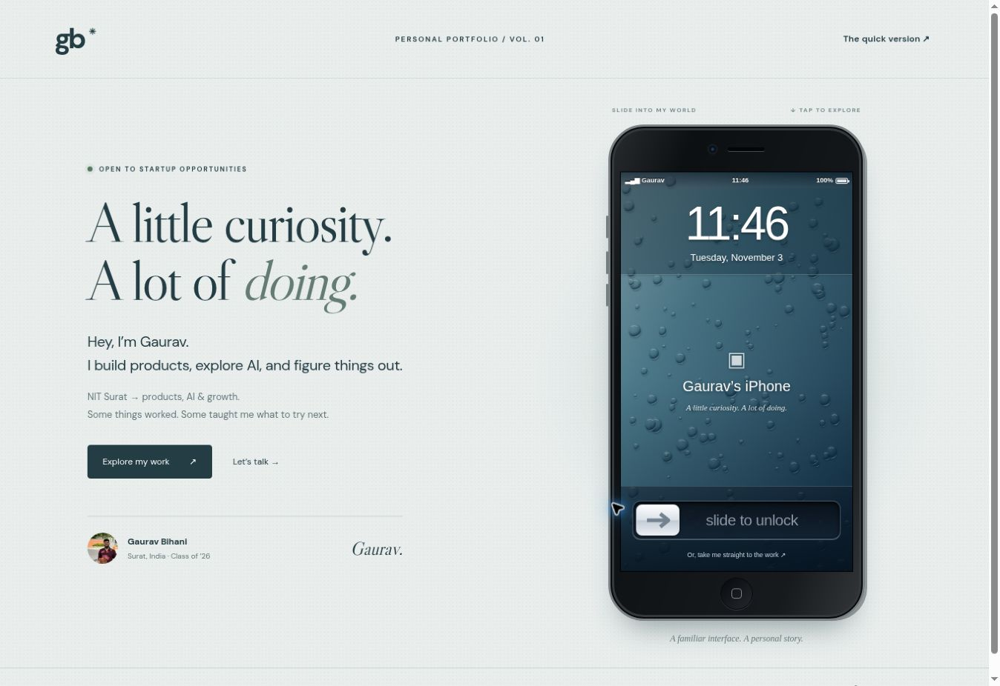

# Gaurav’s iPhone

A responsive, iOS 6-inspired personal portfolio for Gaurav Bihani. Buildless HTML, CSS and JavaScript; static assets in `dist/`.

## Preview
Serve `dist` with a static HTTP server. No dependencies or build step.

## Content
About, Projects (FVI, AthleteOS, MSME team analytics), AI video work, Sports, Photos, Résumé, Contacts and local display preferences. Quick View provides a linear résumé alternative. App routes use URL hashes and support browser Back.

Edit text in `dist/app.js`, styling in `dist/style.css`. Replace files in `dist/assets` to update imagery, intro video or résumé. The supplied résumé includes the user's contact information. No analytics, database or accounts are used by this portfolio.

Project descriptions reflect repository READMEs and user-supplied résumé. FVI is demo software with fictional investor data and no traction; AthleteOS is an unfinished experiment. Sports positions are from the supplied résumé. Channel links are provided; the individual 50K+ views video has not been supplied.

## Accessibility
Semantic buttons, labelled app navigation, keyboard focus outlines, dialog Escape support, reduced motion, browser zoom, native video controls and a text-based quick view.

## Pocket OS interactions

Starts on a classic iPhone-inspired water-droplet wallpaper at every fresh page load. Root visits show a slider lock screen with keyboard and skip-to-work alternatives; direct app links remain accessible. Automatic wallpaper rotation starts after unlocking and cycles classic, beach, mountain and river images every 20 seconds. Manual wallpaper choice pauses rotation. Display motion and rotation toggles persist locally; wallpaper choice does not. Photos support previous/next controls and horizontal swipes.

## Links

- GitHub source: https://github.com/gau-rav0/my-first-repo
- Private portfolio review: https://gaurav-pocket.goodlypond2.chatgpt.site

The complete website, including optimized user-approved personal media and résumé, is included in this public repository.
